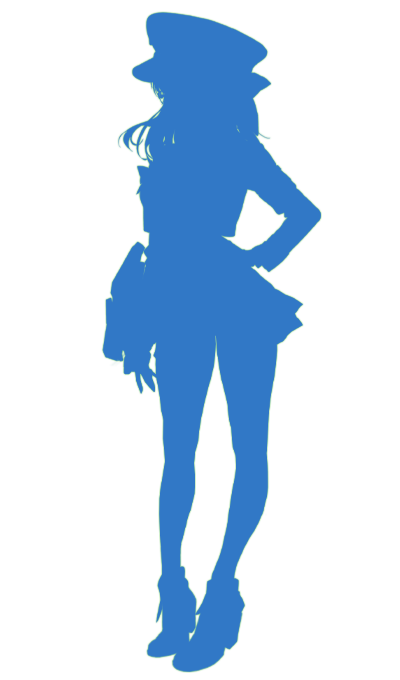

<h4 align="center">Blablalink extension with Union Raid data focused.</h4>

	
	

Union Raid data, right where you need it — Pull Union Raid data with ease. Powered by deterministic season-aware caching and one-click multi-format exports (JSON, CSV, and Interactive charts)

<a href="https://shiftypad.scathach.id/">Installation</a> •
<a href="https://github.com/ScathachGrip/shiftypad-extension/blob/master/CONTRIBUTING.md">Contributing</a> •
<a href="https://github.com/ScathachGrip/shiftypad-extension/issues/new/choose">Report Issues</a>

---

- [shiftypad-extension](#)
  - [The problem](#the-problem)
  - [The solution](#the-solution)
  - [Prerequisites](#prerequisites)
  - [Architecture](/src/)
  - [Data Contracts](#data-contracts)
    - [MemberRow](#data-contracts)
    - [PlayerRaidResult](#data-contracts)
    - [GetMembersResponse](#data-contracts)
    - [Cache keys](#data-contracts)
    - [SEASON_KEY](#data-contracts)
  - [Adaptive Scraper](#adaptive-scraper)
  - [Testing](#testing)
  - [Debugging](#debugging)
    - [Aegis SDK](#aegis-sdk)
    - [ApexCharts](#Apexcharts)
  - [Monolith](#)
    - [shiftypad-extension](/src/)
    - [shiftypad-extension/astro](/astro/)
  - [CLosing remarks](/CLOSING_REMARKS.md)
  - [Legal](#legal)

## The problem

https://www.blablalink.com/shiftyspad/union-raid is highly tedious, that's all.

## The solution

**shiftypad-extension** Manifest V3 Chrome extension designed to transform how Union leaders and players experience Union Raids. By automating data extraction and providing rich, local interactive analytics directly in your browser, it solves these headaches seamlessly:

- **Instant Interactive Analytics:** A sleek displaying responsive visual reports powered by ApexCharts, including player rankings and residual damage.
- **Automated DOM Scraping:** Injects safe page-side content scripts to scrape both summary (`MemberRow`) and detailed attempt-level raid results (`PlayerRaidResult[]`) instantly.
- **Season-Aware Local Cache:** Automatically structures and caches all scraped data per season in `chrome.storage.local`, ensuring fast load times and preventing redundant DOM scraping.
- **One-Click Exports:** Standardizes data exports for external planning or sheet integrations.
- **True Efficiency Analysis (Residuals):** Uses an ordinary least squares (OLS) linear model (`expected_damage = a * synchro + b`) to rank players based on actual performance versus expected baseline, making it easy to identify high-performing members.

### Prerequisites

- [Bun](https://bun.sh) >= 1.4.4 or higher

## Data Contracts

- Summary data is normalized to `MemberRow` (name, count, damage, synchroLevel).
- Detailed scrape data uses `PlayerRaidResult[]` (player, synchro, attempts, damage per boss).
- `GetMembersResponse` bundles union metadata (name, id) with seasonal context (key, text) and data payload.
- Cache keys are deterministic and season-aware:
  - Damage: `ALL_UNION_RAID_DAMAGE_DATA_<IDENTIFIER>__<SEASON_KEY>`
  - Union metadata: `UNION_<IDENTIFIER>__<SEASON_KEY>`
- `IDENTIFIER` is derived from the `openid` query parameter, falling back to the URL pathname.
- `SEASON_KEY` is extracted from the season text in the DOM, falling back to `SEASON_CURRENT`.

## Adaptive Scraper

Blablalink provides a dual-interface architecture featuring a dynamic switch between **Modern Layout (Desktop)** and **Classic Layout (Mobile)** via `data-cname="pc-layout-switch"`. Rather than forcing disruptive layout shifts or requiring users to toggle views, **shiftypad-extension** incorporates a smart, layout-agnostic scraping engine designed to operate natively within whichever viewport the user prefers.

### Architecture & Capabilities

- **Universal Modal Recognition:**
  - **Mobile (Classic Layout):** Renders player attempt details as a bottom-sheet drawer anchored to the bottom viewport (`div.absolute.bottom-0.w-full`).
  - **Desktop (Modern Layout):** Renders player attempt details as a centered, floating dialog constrained to a 720px max-width container (`div.box-border.max-h-[90vh].pointer-events-auto`).
  - The scraper employs polymorphic selector detection (`div.box-border.max-h-[90vh], div.absolute.bottom-0.w-full, div.pointer-events-auto.max-h-[90vh]`) to reliably latch onto the modal lifecycle regardless of viewport geometry or CSS animation state.

- **Geometry-Aware Outside-Click Dismissal:**
  - In Desktop mode, the modal is centered with a fixed maximum width. The dismissal pipeline dynamically computes screen-relative coordinates and dispatches simulated pointer events at `(10, 10)` (top-left backdrop), guaranteeing it strikes the overlay without colliding with the dialog boundaries.
  - In Mobile mode, clicks target the top-center area `(window.innerWidth / 2, 20)` directly above the bottom drawer.
  - Backed by a multi-tiered dismissal cascade including synthetic `PointerEvent` / `MouseEvent` sequences, native `Escape` key event propagation, and DOM overlay/backdrop triggers.

- **Resilient Data Extraction:**
  - **Adaptive Card Containers:** Flexibly parses attempt card heights (`117px` on mobile vs `150px` on desktop) without layout-specific fragility.
  - **Bounded Value Parsing:** Uses strict regex captures (e.g., `/LV\.(\d+)/i`) to prevent textual collisions between player Synchro levels and squad Combat Power metrics.
  - **Comprehensive Hero Squad Attributes:** Extracts complete hero loadouts, star tier progressions (`LB 0` to `LB 3`), core enhancement levels (`Core 1` to `Core 7`, `MAX`), individual Nikke Combat Power, and elemental boss matchups.

## Testing

  
The current coverages is not done yet, you can check `/tests` directory.

## Debugging

### Aegis SDK

Blablalink uses Tencent's Aegis SDK for performance logging, error tracking, and telemetry monitoring on their frontend.

- **Frontend Change Detection:** To prevent DOM structure changes from silently breaking the extension's DOM scrapers, the development environment utilizes the `bun run blablalink:version`.
- **Telemetry Verification:** The script queries `blablalink.com` directly, parses the main entry script to locate the Aegis SDK version, release time, current Vite build slot, and content hash, and matches them against `aegisVersionCache.json`.

### ApexCharts

This extension uses ApexCharts to render modern, interactive data visualizations directly in the extension's popup dashboard.

- **Local Sandbox Compliance:** Because Chrome Extension Manifest V3 enforces strict Content Security Policies (CSP) forbidding the execution of external/remote Javascript, ApexCharts is downloaded locally during the build stage using the `bun run download:apex` command (implemented in `ci/downloadApex.ts`). It retrieves the exact minified runtime version specified in `package.json` and bundles it directly into `dist/apexcharts.min.js`.

## Legal

This tool can be freely copied, modified, altered, distributed without any attribution whatsoever. However, if you feel
like this tool deserves an attribution, mention it. It won't hurt anybody.

> Licence: WTF.
